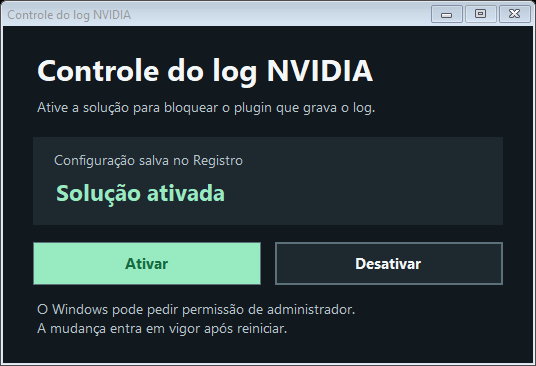

# NVIDIA Fix Disk

[Documentação em português](README.md) · [Source code](ControleNvTopps.cs) · [Download from GitHub Releases](https://github.com/luisbarrelin/nvidia-fix-disk/releases/latest)

A portable Windows tool that applies a temporary workaround for repeated writes to `nvlog.nvlgstg` observed on GeForce driver 621.24. It keeps the installed driver version and prevents **NVIDIA Display Container LS** from loading `_nvtopps.dll`. This is an independent community project.



## Use

1. Download `NVIDIA-Log-Control.exe` from the release. The x64 executable is unsigned. You can verify its SHA-256 hash or build it from source.
2. Open the app. Its Portuguese interface displays the setting saved in the registry and requests Windows administrator approval when you change it.
3. Select **Ativar** (Enable), approve the UAC prompt, and restart Windows. The window reports when the registry value has been saved. The service reads it on its next load.
4. To undo, select **Desativar** (Disable), approve the change, and restart Windows again. This restores the default plugin loading behavior once a fixed driver is installed.

### Verify the download

From the download directory, compare the result with `SHA256SUMS.txt` from the same release:

```powershell
Get-FileHash -LiteralPath '.\NVIDIA-Log-Control.exe' -Algorithm SHA256
```

## Exact change

```text
Key    HKLM\SYSTEM\CurrentControlSet\Services\NVDisplay.ContainerLocalSystem\Parameters\LocalSystem\_nvtopps
Value  DisableLoad (REG_DWORD)
```

Enable writes `1`, creating the plugin subkey if necessary. Disable removes `DisableLoad` when it is `1`, so the subkey may remain empty. An unexpected value triggers a read error and is preserved.

The C# Windows Forms app starts with a read-only registry operation. A change launches an elevated copy of the same executable, which updates and re-reads that one value. The internal `--ativar` and `--desativar` arguments require administrator rights. The UI reads back the resulting state. The tool makes no network connections, does not install components, create scheduled tasks, delete driver files or logs, or restart Windows or the service. The NVIDIA driver and service remain installed.

## Verify after restarting

Run the read-only PowerShell commands in [the verification section](README.md#como-confirmar-depois-do-reinício). An active workaround should show `DisableLoad = 1`. If the service log is available, look for a **current-boot** entry saying `_nvtopps.dll` was skipped. Sample `nvlog.nvlgstg` over time to see whether it stays absent or unchanged. Older archived logs can remain on disk. File growth measures net size, so use Windows Resource Monitor to inspect disk write activity by filename when you need I/O measurements.

## Validation and limitations

- Verified on one Windows 11 system with a GeForce RTX 3090 and driver 621.24. After restarting, the registry setting persisted, the service reported skipping the plugin, and the active log was absent eight minutes into the new session. Two old logs stayed unchanged over a one-minute sample. The driver was still on 621.24.
- App startup and the registry state display were verified. The registry workaround and post-reboot result were tested separately. The complete two-button workflow, including UAC and rollback, has not been tested end to end.
- Disabling this plugin may reduce its diagnostic logs. Games, CUDA, DLSS, G-SYNC, NVIDIA App features, and automatic GPU tuning were not tested in a compatibility matrix. Verify any features you rely on and revert the workaround if you observe a regression.
- The issue has also been reported on 621.14. Other drivers, machines, and Windows versions have not been verified. Future NVIDIA updates may change the registry setting, the plugin, or the need for the workaround.

## Build from source

Use x64 Windows with .NET Framework and its 64-bit `csc.exe` compiler. The build uses .NET Framework libraries without NuGet dependencies. From the repository root:

```powershell
powershell.exe -NoProfile -File .\build.ps1
```

The build creates `build\NVIDIA-Log-Control.exe` using the same compiler settings as the original release. Locally compiled binaries may have different hashes.

When reporting a problem, include your Windows version, GPU, driver version, reboot result, and reproduction steps. Remove usernames, identifiers, and personal paths from any log excerpts.

## References and license

- [GeForce 621.24 driver page](https://www.nvidia.com/en-us/geforce/drivers/details/285321/)
- [GeForce forum discussion](https://www.nvidia.com/en-us/geforce/forums/game-ready-drivers/13/592907/continuous-writing-of-gigabytes-to-ssd-to-nvtopps-/)
- [Community registry workaround and Process Monitor check](https://old.reddit.com/r/nvidia/comments/1xuef1f/comment/19su1doggqogy/)
- [MIT license](LICENSE)
