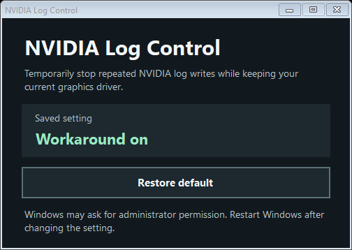
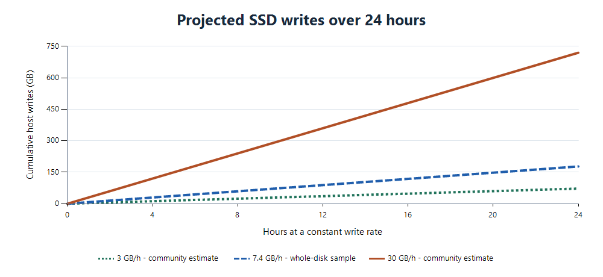
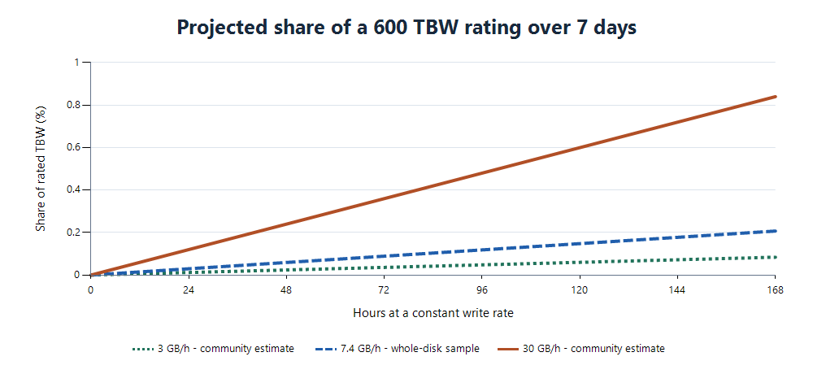

# NVIDIA Fix Disk

[Português](README.pt-BR.md) · [简体中文](README.zh-CN.md) · [Source code](ControleNvTopps.cs) · [Download](https://github.com/luisbarrelin/nvidia-fix-disk/releases/latest)

A portable Windows tool for repeated `nvlog.nvlgstg` writes reported on some NVIDIA GeForce systems. The temporary workaround keeps the installed graphics driver and prevents **NVIDIA Display Container LS** from loading its `_nvtopps.dll` plugin. This is an independent community project.



## What is happening

On affected Windows systems, `NVDisplay.Container.exe` repeatedly rewrites the binary log `%ProgramData%\NVIDIA Corporation\nvtopps\nct\nvlog.nvlgstg`. Rewriting existing data explains why the saved file can stay small while the system continues issuing write operations. To check your PC, open **Resource Monitor → Disk → Disk Activity** and look for frequent writes to that exact filename from `NVDisplay.Container.exe`. Use the filename and sustained activity together when diagnosing it.

Community reports include GeForce drivers **621.14** and **621.24** and multiple GPU models, including a [GeForce RTX 4070 SUPER report](https://www.reddit.com/r/nvidia/comments/1xuef1f/game_ready_driver_62124_faqdiscussion/) and a [GeForce RTX 4090 report](https://www.reddit.com/r/nvidia/comments/1xzchfu/nvidia_driver_writes_to_the_ssd_constantly/). Other users with the same driver versions could not reproduce it. These reports are examples, and the presence of a GPU on NVIDIA's compatibility list does not establish that it is affected. The RTX 3090 below is one local verification case.

## How much can it write?

| Source | Approximate rate | What it represents |
| --- | ---: | --- |
| [Community reports summarized by Tom's Hardware](https://www.tomshardware.com/pc-components/gpu-drivers/nvidia-geforce-driver-bug-reportedly-hammers-ssds-with-up-to-30gb-of-writes-per-hour-users-trace-massive-idle-wear-to-background-service-newer-driver-reportedly-still-affected) | **3 GB/h** and **30 GB/h** | Estimates from separate affected setups. The higher figure was reported with 621.24. |
| Local verification, Windows physical disk counter | **7.4 GB/h equivalent** | About 83 MB in 40 seconds across the whole Samsung SSD 980, from all processes. The test does not isolate NVIDIA's share. |
| Local verification, NVIDIA process counter | **71 GB/h equivalent** | 1.30 GB in 66 seconds of total process I/O writes. This is a process counter and was excluded from SSD projections. |

The local rates are extrapolations from short samples. Windows can buffer file writes in memory, and process counters and disk counters measure different things. [Microsoft's file caching documentation](https://learn.microsoft.com/en-us/windows/win32/fileio/file-caching)

### Write volume by hour

The chart and table assume each rate holds continuously. They show hypothetical write volume using decimal GB and TB. Replace the rate with one measured on your system for a local estimate.



| Hours | 3 GB/h | 7.4 GB/h | 30 GB/h |
| ---: | ---: | ---: | ---: |
| 1 | 3 GB | 7.4 GB | 30 GB |
| 2 | 6 GB | 14.8 GB | 60 GB |
| 3 | 9 GB | 22.2 GB | 90 GB |
| 4 | 12 GB | 29.6 GB | 120 GB |
| 5 | 15 GB | 37.0 GB | 150 GB |
| 6 | 18 GB | 44.4 GB | 180 GB |
| 7 | 21 GB | 51.8 GB | 210 GB |
| 8 | 24 GB | 59.2 GB | 240 GB |
| 12 | 36 GB | 88.8 GB | 360 GB |
| 24 | 72 GB | 177.6 GB | 720 GB |
| 48 | 144 GB | 355.2 GB | 1.44 TB |
| 168 | 504 GB | 1.24 TB | 5.04 TB |

### SSD write endurance example

Samsung rates the **1 TB SSD 980** for **600 TBW**. At a hypothetical sustained 30 GB/h, 1 hour is **0.005%**, 24 hours is **0.12%**, and 168 hours is **0.84%** of that rating. At 7.4 GB/h, 24 hours is about **0.030%**. These percentages compare projected host writes with a manufacturer's rated write endurance. SSD health and failure timing cannot be inferred from this calculation. Use the TBW rating for your own SSD model and capacity. [Samsung SSD 980 datasheet](https://download.semiconductor.samsung.com/resources/data-sheet/Samsung_NVMe_SSD_980_Data_Sheet_Rev.1.1_10129514071718.pdf)



`Projected GB = hours × GB/h` and `Share of TBW (%) = projected GB ÷ rated TBW in GB × 100`. The two charts can be regenerated with [generate-charts.ps1](generate-charts.ps1) in Windows PowerShell 5.1.

## Use

1. Download `NVIDIA-Log-Control.exe` from the release. The x64 executable is unsigned. You can verify its SHA-256 hash or build it from source.
2. Open the app and check the saved status. It automatically uses the Windows display language for English, Portuguese, and Simplified Chinese. Other languages fall back to English.
3. Select **Turn on workaround**, approve the Windows administrator prompt, and restart Windows. The service reads the setting on its next startup.
4. To undo the change, select **Restore default**, approve the prompt, and restart. You can use this after installing a driver that resolves the issue.

### Verify the download

From the download directory, compare the result with `SHA256SUMS.txt` from the same release:

```powershell
Get-FileHash -LiteralPath '.\NVIDIA-Log-Control.exe' -Algorithm SHA256
```

## Exact change

```text
Key    HKLM\SYSTEM\CurrentControlSet\Services\NVDisplay.ContainerLocalSystem\Parameters\LocalSystem\_nvtopps
Value  DisableLoad (REG_DWORD)
```

Enable writes `1`, creating the plugin subkey if necessary. Disable removes `DisableLoad` when it is `1`, so the subkey may remain empty. An unexpected value triggers a read error and is preserved.

The C# Windows Forms app starts with a read-only registry operation. A change launches an elevated copy of the same executable, which updates and re-reads that one value. The internal `--ativar` and `--desativar` arguments require administrator rights. The UI reads back the resulting state. The tool makes no network connections, does not install components, create scheduled tasks, delete driver files or logs, or restart Windows or the service. The NVIDIA driver and service remain installed.

## Verify after restarting

Run these read-only checks in PowerShell. An active workaround should show `DisableLoad = 1`. If the service log is available, look for a **current-boot** entry saying `_nvtopps.dll` was skipped. Sample `nvlog.nvlgstg` over time to see whether it stays absent or unchanged. Older archived logs can remain on disk.

```powershell
$key = 'HKLM:\SYSTEM\CurrentControlSet\Services\NVDisplay.ContainerLocalSystem\Parameters\LocalSystem\_nvtopps'
Get-ItemPropertyValue -LiteralPath $key -Name DisableLoad

$serviceLog = Join-Path $env:ProgramData 'NVIDIA\NVDisplay.ContainerLocalSystem.log'
if (Test-Path -LiteralPath $serviceLog) {
    Select-String -LiteralPath $serviceLog -Pattern 'Disable loading of plugin.*_nvtopps\.dll' |
        Select-Object -Last 1
}

$logDir = Join-Path $env:ProgramData 'NVIDIA Corporation\nvtopps\nct'
if (Test-Path -LiteralPath $logDir) {
    Get-ChildItem -LiteralPath $logDir -Force | Select-Object Name, Length, LastWriteTime
}
```

## Validation and limitations

- Verified on one Windows 11 system with a GeForce RTX 3090 and driver 621.24. After restarting, the registry setting persisted, the service reported skipping the plugin, and the active log was absent eight minutes into the new session. Two old logs stayed unchanged over a one-minute sample. The driver was still on 621.24.
- The interface and automatic language selection were checked without changing the NVIDIA registry setting. The complete action flow, including UAC and rollback, has not been tested end to end in this release.
- Disabling this plugin may reduce its diagnostic logs. Games, CUDA, DLSS, G-SYNC, NVIDIA App features, and automatic GPU tuning were not tested in a compatibility matrix. Verify any features you rely on and revert the workaround if you observe a regression.
- The issue has also been reported on 621.14. Other drivers, machines, and Windows versions have not been verified. Future NVIDIA updates may change the registry setting, the plugin, or the need for the workaround.

## Build from source

Use x64 Windows with .NET Framework and its 64-bit `csc.exe` compiler. The build uses .NET Framework libraries without NuGet dependencies. From the repository root:

```powershell
powershell.exe -NoProfile -ExecutionPolicy RemoteSigned -File .\build.ps1
```

The build creates `build\NVIDIA-Log-Control.exe`. `RemoteSigned` applies to that PowerShell process. Locally compiled binaries may have different hashes.

When reporting a problem, include your Windows version, GPU, driver version, reboot result, and reproduction steps. Remove usernames, identifiers, and personal paths from any log excerpts.

## References and license

- [GeForce 621.24 driver page](https://www.nvidia.com/en-us/geforce/drivers/details/285321/)
- [GeForce forum discussion](https://www.nvidia.com/en-us/geforce/forums/game-ready-drivers/13/592907/continuous-writing-of-gigabytes-to-ssd-to-nvtopps-/)
- [Community registry workaround and Process Monitor check](https://old.reddit.com/r/nvidia/comments/1xuef1f/comment/19su1doggqogy/)
- [MIT license](LICENSE)
