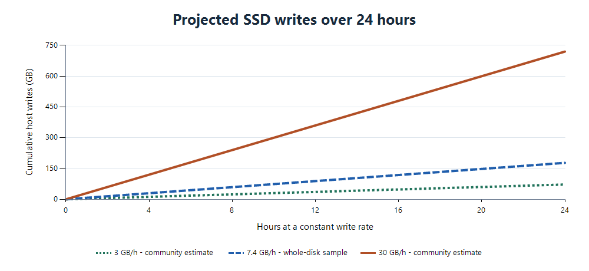
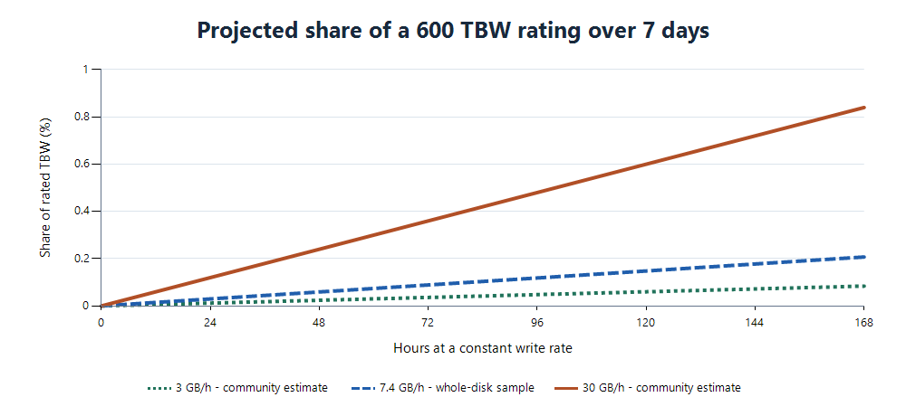

# NVIDIA Fix Disk

[English](README.md) · [简体中文](README.zh-CN.md) · [Código-fonte](ControleNvTopps.cs) · [Baixar pela GitHub Release](https://github.com/luisbarrelin/nvidia-fix-disk/releases/latest)

Utilitário portátil para Windows que aplica uma solução temporária para as regravações de `nvlog.nvlgstg` relatadas em alguns PCs com NVIDIA GeForce. A ferramenta mantém o driver instalado e impede que o serviço **NVIDIA Display Container LS** carregue o plugin `_nvtopps.dll`. É um projeto independente da comunidade.

## O que está acontecendo

Em máquinas afetadas, `NVDisplay.Container.exe` regrava repetidamente o log binário `%ProgramData%\NVIDIA Corporation\nvtopps\nct\nvlog.nvlgstg`. O volume gravado pode ser bem maior que o tamanho salvo do arquivo. No **Monitor de Recursos → Disco → Atividade do Disco**, procure gravações frequentes nesse caminho e por esse processo antes de aplicar a medida.

Há relatos nos drivers **621.14** e **621.24**, incluindo sistemas com [RTX 4070 SUPER](https://www.reddit.com/r/nvidia/comments/1xuef1f/game_ready_driver_62124_faqdiscussion/) e [RTX 4090](https://www.reddit.com/r/nvidia/comments/1xzchfu/nvidia_driver_writes_to_the_ssd_constantly/). Outros usuários nas mesmas versões não reproduziram o problema. Os modelos citados são exemplos, e o teste local em uma RTX 3090 é apenas um caso de verificação.

## Quanto grava por hora?

Há relatos de **aproximadamente 3 GB/h e 30 GB/h** em sistemas diferentes. No teste local, o contador do **SSD inteiro** registrou cerca de **83 MB em 40 segundos**, equivalentes a **7,4 GB/h** caso aquele ritmo se mantivesse. O número inclui todos os processos. O contador separado do processo NVIDIA equivalia a cerca de **71 GB/h de operações de escrita**, excluídas das projeções de SSD. O Windows pode usar cache para gravações. [Relatos resumidos pelo Tom's Hardware](https://www.tomshardware.com/pc-components/gpu-drivers/nvidia-geforce-driver-bug-reportedly-hammers-ssds-with-up-to-30gb-of-writes-per-hour-users-trace-massive-idle-wear-to-background-service-newer-driver-reportedly-still-affected) · [Documentação da Microsoft](https://learn.microsoft.com/en-us/windows/win32/fileio/file-caching)



A **30 GB/h constantes**, são **30 GB em 1 hora**, **60 GB em 2 horas**, **90 GB em 3 horas** e **720 GB em 24 horas**. Em um SSD de **600 TBW**, como o Samsung 980 de 1 TB, isso equivale a **0,12% da classificação de gravação em 24 horas** ou **0,84% após sete dias**. São projeções condicionadas à taxa escolhida. A saúde real e a vida útil restante do SSD exigem medições próprias. [Tabela completa e metodologia](README.md#write-volume-by-hour) · [Ficha técnica da Samsung](https://download.semiconductor.samsung.com/resources/data-sheet/Samsung_NVMe_SSD_980_Data_Sheet_Rev.1.1_10129514071718.pdf)



## Usar

1. Baixe `NVIDIA-Log-Control.exe` na release. O executável x64 é distribuído sem assinatura digital. É possível conferir o SHA-256 ou compilar pelo código-fonte.
2. Abra o executável. A janela mostra o estado salvo no Registro e segue automaticamente o idioma de exibição do Windows. O aplicativo oferece inglês, português e chinês simplificado. Para outros idiomas, exibe inglês.
3. Clique em **Ativar solução**, conceda a autorização do Windows e reinicie o computador. O serviço usa o valor salvo na próxima inicialização.
4. Para desfazer, clique em **Restaurar padrão**, autorize a alteração e reinicie novamente. Use essa opção após instalar um driver que resolva o problema.

### Verificar o executável

Na pasta em que salvou os arquivos, compare o hash retornado com o conteúdo de `SHA256SUMS.txt` da mesma release:

```powershell
Get-FileHash -LiteralPath '.\NVIDIA-Log-Control.exe' -Algorithm SHA256
```

## O que a ferramenta altera

A interface em C# e Windows Forms lê o Registro ao abrir. Cada clique de alteração inicia uma segunda instância do próprio executável com elevação via UAC. Essa instância grava ou remove um único valor e verifica o resultado. A interface faz a leitura novamente ao final.

```text
Chave  HKLM\SYSTEM\CurrentControlSet\Services\NVDisplay.ContainerLocalSystem\Parameters\LocalSystem\_nvtopps
Valor  DisableLoad (REG_DWORD)
```

| Ação | Efeito |
| --- | --- |
| Ativar solução | Define `DisableLoad` como `1`, criando a chave do plugin se necessário. |
| Restaurar padrão | Remove `DisableLoad` quando está em `1`. A chave pode permanecer vazia. |

O código preserva valores inesperados e apresenta erro de leitura. Ele não reinicia o serviço ou o Windows, não exclui logs ou arquivos do driver, não instala componentes, não cria tarefas agendadas e não faz conexões de rede. O driver e o serviço permanecem instalados. Os dois argumentos internos `--ativar` e `--desativar` exigem uma execução já elevada e retornam um código de saída para a interface.

## Como confirmar depois do reinício

Execute em PowerShell:

```powershell
$key = 'HKLM:\SYSTEM\CurrentControlSet\Services\NVDisplay.ContainerLocalSystem\Parameters\LocalSystem\_nvtopps'
Get-ItemPropertyValue -LiteralPath $key -Name DisableLoad

$serviceLog = Join-Path $env:ProgramData 'NVIDIA\NVDisplay.ContainerLocalSystem.log'
if (Test-Path -LiteralPath $serviceLog) {
    Select-String -LiteralPath $serviceLog -Pattern 'Disable loading of plugin.*_nvtopps\.dll' |
        Select-Object -Last 1
}

$logDir = Join-Path $env:ProgramData 'NVIDIA Corporation\nvtopps\nct'
if (Test-Path -LiteralPath $logDir) {
    Get-ChildItem -LiteralPath $logDir -Force | Select-Object Name, Length, LastWriteTime
}
```

Com a solução ativa, espere `1` no Registro. Se o log do serviço estiver disponível, procure uma entrada do **reinício mais recente** indicando que o plugin deixou de carregar. Verifique após um intervalo se o `nvlog.nvlgstg` continua ausente ou sem novas alterações. Arquivos de log antigos podem permanecer. O crescimento de um arquivo mede tamanho líquido. Para observar gravações, examine a atividade de disco no Monitor de Recursos e filtre pelo nome do arquivo.

## Validação e limitações

- **Verificado em uma máquina** com Windows 11, GeForce RTX 3090 e driver 621.24. Depois do reboot, `DisableLoad` continuou em `1`, o serviço registrou que ignorou o plugin e o arquivo ativo estava ausente ao fim de oito minutos. Dois logs antigos ficaram estáveis durante um minuto de amostragem. O driver continuou na versão 621.24.
- Verificamos a janela e a seleção automática de idioma sem alterar a configuração da NVIDIA. O fluxo completo de alteração, incluindo UAC e reversão, não passou por teste de ponta a ponta nesta versão.
- A mudança pode reduzir os registros de diagnóstico associados ao plugin. Não há uma matriz de testes para jogos, CUDA, DLSS, G-SYNC, NVIDIA App ou ajuste automático da GPU. Teste os recursos que usa e reverta se observar uma regressão.
- O defeito também foi relatado em 621.14. O projeto não confirma o comportamento em outros drivers, PCs ou versões do Windows. Uma atualização do driver pode mudar a chave, o funcionamento do plugin ou a necessidade da solução.

## Compilar

Requisitos: Windows x64 com .NET Framework e o compilador `csc.exe` de 64 bits. A compilação usa somente bibliotecas do .NET Framework e não depende de pacotes NuGet. Execute na raiz do projeto:

```powershell
powershell.exe -NoProfile -ExecutionPolicy RemoteSigned -File .\build.ps1
```

O resultado é `build\NVIDIA-Log-Control.exe`. A opção `RemoteSigned` se aplica a esse processo do PowerShell. Compilações locais podem gerar hashes diferentes.

Para relatar um problema, inclua versão do Windows, modelo da GPU, versão do driver, resultado após reiniciar e etapas para reproduzir. Remova identificadores, nomes de usuário e caminhos pessoais antes de anexar logs.

## Referências e licença

- [Página do driver GeForce 621.24](https://www.nvidia.com/en-us/geforce/drivers/details/285321/)
- [Discussão do problema no fórum GeForce](https://www.nvidia.com/en-us/geforce/forums/game-ready-drivers/13/592907/continuous-writing-of-gigabytes-to-ssd-to-nvtopps-/)
- [Relato do ajuste no Registro e verificação com Process Monitor](https://old.reddit.com/r/nvidia/comments/1xuef1f/comment/19su1doggqogy/)
- [Licença MIT](LICENSE)
