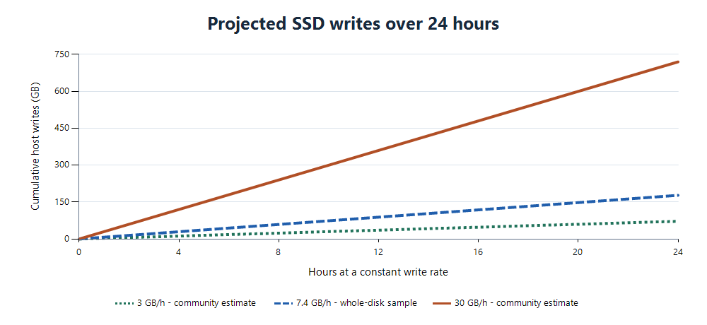
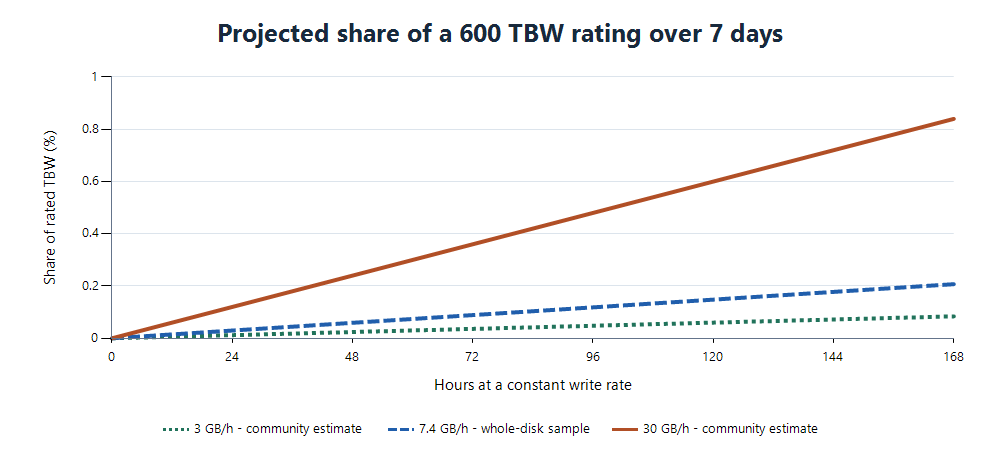

# NVIDIA Fix Disk

[English](README.md) · [Português](README.pt-BR.md) · [源代码](ControleNvTopps.cs) · [下载](https://github.com/luisbarrelin/nvidia-fix-disk/releases/latest)

这是一款便携式 Windows 工具，为部分 NVIDIA GeForce 电脑上的 `nvlog.nvlgstg` 重复写入问题提供临时解决方案。它保留当前显卡驱动，并阻止 **NVIDIA Display Container LS** 加载 `_nvtopps.dll` 插件。本项目由社区维护。

## 问题和适用范围

受影响的电脑上，`NVDisplay.Container.exe` 会反复重写 `%ProgramData%\NVIDIA Corporation\nvtopps\nct\nvlog.nvlgstg` 二进制日志。由于已有内容会被重写，文件本身可能很小，但累计写入量仍然较大。请打开 **资源监视器 → 磁盘 → 磁盘活动**，检查该进程是否频繁写入这个文件。

社区报告涉及 GeForce **621.14** 和 **621.24** 驱动，以及 [RTX 4070 SUPER](https://www.reddit.com/r/nvidia/comments/1xuef1f/game_ready_driver_62124_faqdiscussion/)、[RTX 4090](https://www.reddit.com/r/nvidia/comments/1xzchfu/nvidia_driver_writes_to_the_ssd_constantly/) 等不同显卡。也有人在相同版本上未复现。项目在一台装有 RTX 3090 的 Windows 11 电脑上验证了重启后的效果，这只是一个验证案例。

## 每小时写入多少？

社区报告在不同电脑上给出的估计值约为 **3 GB/小时**和 **30 GB/小时**。本地测试在 40 秒内记录到整个 SSD 写入约 83 MB，相当于 **7.4 GB/小时**，其中包含所有进程。NVIDIA 进程的写入计数器另行测量，约等效于 **71 GB/小时**，未计入 SSD 写入量预测。Windows 可以缓存写入，因此两个计数器的含义不同。[社区报告汇总](https://www.tomshardware.com/pc-components/gpu-drivers/nvidia-geforce-driver-bug-reportedly-hammers-ssds-with-up-to-30gb-of-writes-per-hour-users-trace-massive-idle-wear-to-background-service-newer-driver-reportedly-still-affected) · [Microsoft 文件缓存说明](https://learn.microsoft.com/en-us/windows/win32/fileio/file-caching)



如果持续以 **30 GB/小时**写入，1、2、3 小时分别写入 **30、60、90 GB**，24 小时为 **720 GB**。以额定 **600 TBW** 的 SSD 为例，24 小时约占额定总写入量的 **0.12%**，7 天约占 **0.84%**。这是按恒定速率计算的示例，不能据此判断 SSD 的实际健康状况或剩余寿命。[完整表格与计算方法](README.md#write-volume-by-hour) · [三星 SSD 980 规格](https://download.semiconductor.samsung.com/resources/data-sheet/Samsung_NVMe_SSD_980_Data_Sheet_Rev.1.1_10129514071718.pdf)



## 使用和恢复

1. 从发布页下载 Windows x64 版 `NVIDIA-Log-Control.exe`。程序未进行数字签名。可用发布页上的 `SHA256SUMS.txt` 核对文件哈希，也可自行编译。
2. 打开程序。它根据 Windows 显示语言自动选择英语、葡萄牙语或简体中文，其他语言使用英语。
3. 点击 **启用临时方案**，同意 Windows 管理员权限提示，然后重新启动电脑。
4. 装好修复此问题的驱动后，点击 **恢复默认设置**，同意权限提示并再次重启。

启用时，程序在 `HKLM\SYSTEM\CurrentControlSet\Services\NVDisplay.ContainerLocalSystem\Parameters\LocalSystem\_nvtopps` 下将 `DisableLoad`（`REG_DWORD`）设为 `1`。恢复默认设置时，如果该值为 `1`，程序仅删除 `DisableLoad`。程序不会主动重启、联网、删除日志或驱动文件。[重启后验证方法](README.md#verify-after-restarting)

禁用插件可能会减少相关诊断日志。本版本验证了界面和自动语言选择，尚未完成管理员权限与恢复流程的端到端测试，也未覆盖所有显卡、驱动及 NVIDIA 功能。

## 从源代码编译

需要带有 64 位 `csc.exe` 的 Windows x64 和 .NET Framework。在仓库根目录运行：

```powershell
powershell.exe -NoProfile -ExecutionPolicy RemoteSigned -File .\build.ps1
```

生成的文件位于 `build\NVIDIA-Log-Control.exe`。[MIT 许可证](LICENSE)
